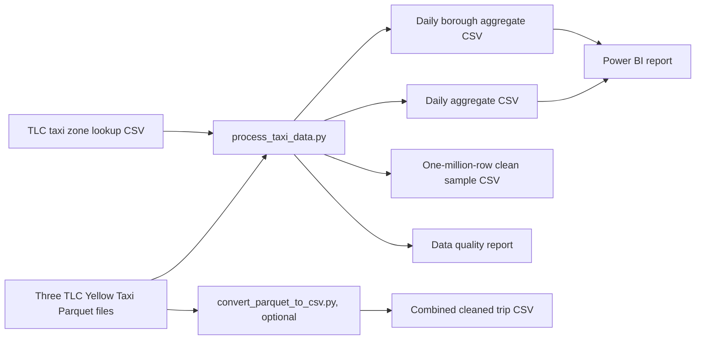
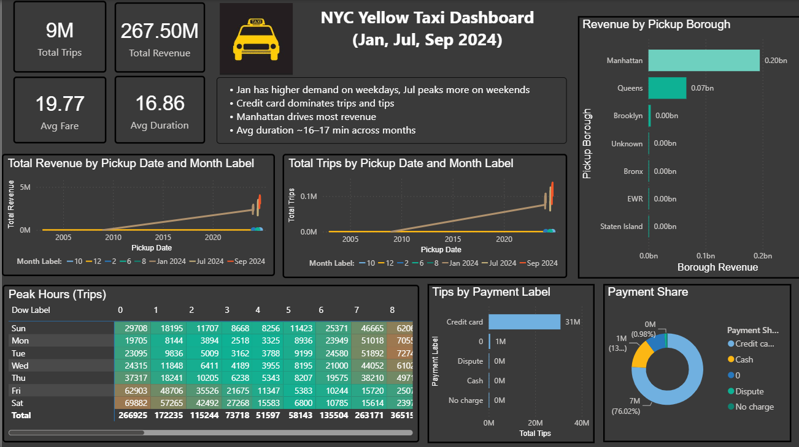
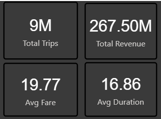
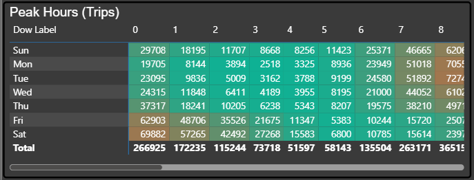
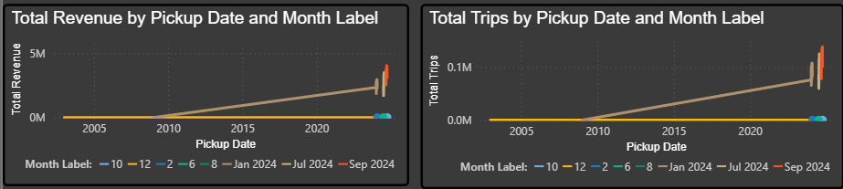
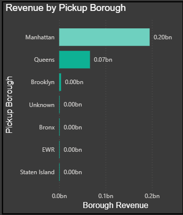

# NYC Yellow Taxi Power BI Dashboard

## Project overview

An analysis of New York City yellow taxi trips from January, July, and September 2024. Python cleans the public trip records and produces daily and pickup-borough aggregates; a one-page Power BI report presents trip demand, revenue, fares, duration, payment mix, and borough comparisons.

## Business problem

How do trip volume and revenue vary by day, hour, and selected month? Which payment types account for trips and tips? Which pickup boroughs contribute the most revenue? The report addresses these questions with cards, trends, a peak-hours matrix, and categorical charts.

## Key features

- Data-quality counts, duration and date features, invalid-trip filtering, outlier caps, and a taxi-zone lookup join.
- Daily and borough CSV aggregates for Power BI.
- One Power BI report page with four KPI cards and six analysis visuals.

## Technology stack

Python with `pandas`, `numpy`, and `pyarrow`; Parquet and CSV datasets; Power BI Desktop and a `.pbix` report; Git LFS for publishing the report file.

## Data sources

The input is the [NYC Taxi and Limousine Commission (TLC) trip record data](https://www.nyc.gov/site/tlc/about/tlc-trip-record-data.page): [January 2024](https://d37ci6vzurychx.cloudfront.net/trip-data/yellow_tripdata_2024-01.parquet), [July 2024](https://d37ci6vzurychx.cloudfront.net/trip-data/yellow_tripdata_2024-07.parquet), and [September 2024](https://d37ci6vzurychx.cloudfront.net/trip-data/yellow_tripdata_2024-09.parquet) Yellow Taxi Parquet files. The [taxi zone lookup](https://d37ci6vzurychx.cloudfront.net/misc/taxi_zone_lookup.csv) supplies pickup-borough labels. TLC notes that trip data are supplied by technology providers and may have accuracy limitations.

| Input file | Raw records, from Parquet metadata | Local size |
| --- | ---: | ---: |
| January 2024 | 2,964,624 | 47.65 MiB |
| July 2024 | 3,076,903 | 49.88 MiB |
| September 2024 | 3,633,030 | 58.34 MiB |
| **Total** | **9,674,557** | **155.86 MiB** |

These are three selected months, not a continuous 2024 series. The output contains 112 trips whose recorded pickup dates fall outside the three named months; the observed aggregate date range is 2002-12-31 through 2024-10-01. These anomalous dates need a data-quality decision before drawing strict month-to-month conclusions.

## Data processing pipeline

Run scripts from the project root. `scripts/process_taxi_data.py` reads the three named Parquet files, selects nine fields, drops missing pickup/dropoff dates, derives month/date/hour/day-of-week and duration, removes trips with nonpositive duration or distance or negative total amount, and caps distance at 100 miles, duration at 300 minutes, and total amount at $1,000. It joins pickup location IDs to boroughs, aggregates trip counts and financial/distance/duration fields, creates a one-million-row cleaned sample, and writes a quality report. It loads each monthly file into memory in turn; it does not stream that processing step.

`scripts/convert_parquet_to_csv.py` is an **independent, optional** path. It iterates Parquet batches, applies similar basic filters and caps, and writes a full combined cleaned CSV. It does not produce the Power BI aggregates or join boroughs. The three per-month cleaned CSVs present locally are not generated by either current script; their creation code is missing.



The report layout references tables named `yellow_agg_daily` and `yellow_agg_daily_borough`, matching the two aggregate outputs. Power Query source paths, refresh settings, and model relationships still require inspection in Power BI Desktop.

## Dashboard overview

The PBIX layout contains one page, **Page 1**, titled “NYC Yellow Taxi Dashboard (Jan, Jul, Sep 2024).” It has four KPI cards and six analysis visuals: two lines for trips and revenue by pickup date, a day-of-week by hour peak-trips matrix, a payment-share donut, tips by payment label bars, and revenue by pickup borough bars. The report page also contains text and an image. No slicer is visible in the inspected layout.

## Key performance indicators

| KPI card | Field referenced by the report | Displayed value / cross-check |
| --- | --- | --- |
| Total Trips | `yellow_agg_daily.Total Trips` | Card displays **9M**; aggregate `trip_count` sums to **9,354,867** |
| Total Revenue | `yellow_agg_daily.Total Revenue` | Card displays **267.50M**; aggregate `trip_count × avg_total_amount` sums to **$267,501,699.33** |
| Avg Fare | `yellow_agg_daily.Avg Fare` | Card displays **19.77**; trip-weighted aggregate `avg_fare_amount` is **$19.77** |
| Avg Duration | `yellow_agg_daily.Avg Duration` | Card displays **16.86**; trip-weighted aggregate `avg_trip_duration` is **16.86 minutes** |

Displayed values are read from the genuine KPI screenshot; the corresponding precise values are independently calculated from the CSV. The card abbreviates trip count and revenue. The layout references nine distinct named measures in total; their DAX definitions remain unverified. See [the audit](docs/PROJECT_AUDIT.md) for the complete evidence and limits.

## Dashboard screenshots

These are genuine captures of the report's single page. The full-page image shows all four KPI cards and six analysis visuals. The earlier personal identifier is absent from the supplied captures.

### Dashboard overview



The complete page combines trip and revenue cards, daily trends, peak hours, payment mix, tips, and pickup-borough revenue.

### Key performance indicators



The four cards display Total Trips, Total Revenue, Avg Fare, and Avg Duration with the report's actual formatting.

### Peak-hours analysis



The day-of-week by pickup-hour matrix shows trip counts for hours 0–8. The Power BI visual has a horizontal scrollbar for later hours.

### Demand and revenue trends



These line charts plot trips and revenue by pickup date and month label. Anomalous source dates stretch the timeline back to 2002; interpret the lines with that data-quality limit in mind.

### Pickup-borough comparison



The bar chart compares revenue across pickup boroughs; Manhattan and Queens have the largest bars. This is a borough comparison, not a geographic map.

## Key analytical insights

- The daily aggregate totals **9,354,867 cleaned trips**, compared with **9,674,557 raw records**; the quality report attributes the difference of **319,690** to invalid-trip filters. This is a **3.30%** drop rate.
- September has **3,500,220** cleaned trips, July **2,982,514**, and January **2,872,028** when grouped by the derived pickup month. A further **105** trips fall into other month numbers, reflecting anomalous dates; do not treat the selected months as a complete annual trend.
- Manhattan accounts for **8,264,507 trips (88.34%)** and **$195.11 million (72.94%)** of reconstructed total amount in the borough aggregate. “Unknown” pickup boroughs account for **29,461 trips**.
- Payment code `1` represents **7,111,256 trips (76.02%)** and **$30.87 million** of the aggregate's **$31.52 million** in recorded tips. The TLC [yellow taxi data dictionary](https://www.nyc.gov/assets/tlc/downloads/pdf/data_dictionary_trip_records_yellow.pdf) identifies code `1` as credit card and says cash tips are not included in `tip_amount`. These figures come from the CSV, not a report screenshot.

## Project structure

```text
.
├── .gitattributes
├── .gitignore
├── README.md
├── requirements.txt
├── Taxi_Dashboard.pbix           # Git LFS on publication
├── assets/screenshots/           # five genuine GitHub PNGs and capture notes
├── data/README.md
├── data/samples/yellow_clean_sample_1000.csv
├── data_raw/                     # local downloaded Parquet files; ignored by Git
├── data_ref/taxi_zone_lookup.csv
├── docs/PROJECT_AUDIT.md
├── outputs/
│   ├── data_quality_report.txt
│   ├── yellow_agg_daily.csv
│   ├── yellow_agg_daily_borough.csv
│   ├── screenshots/               # matching original PNG captures
│   └── [large local trip-level CSVs ignored by Git]
└── scripts/
    ├── convert_parquet_to_csv.py
    └── process_taxi_data.py
```

## Installation and usage

1. Install Python 3 and dependencies: `python -m pip install -r requirements.txt`.
2. Download the three source Parquet files linked above into `data_raw/` with the filenames shown in the links. The zone lookup is included in `data_ref/`.
3. From the project root, run `python scripts/process_taxi_data.py` **only when you intend to regenerate** the aggregate CSVs, sample, and quality report; this script overwrites those existing outputs. It may use substantial memory because it loads a full month at a time.
4. Open `Taxi_Dashboard.pbix` in Power BI Desktop. Review the Power Query sources and point them at the local `outputs/` aggregate files if necessary, then refresh. Source paths and model refresh behavior have not been independently verified.

`python scripts/convert_parquet_to_csv.py` is optional and writes `outputs/yellow_tripdata_2024_combined_cleaned.csv`. It removes an existing file of that name before writing, so preserve the current output before running it.

## Reproducibility

The prepared Git file set includes the scripts, zone lookup, 1,000 actual sample rows, aggregate CSVs, quality report, and—once reviewed and published—PBIX via Git LFS. The three source Parquet files and large trip-level outputs are local only. The quality report's “Approx” label is conservative; the aggregate `trip_count` sum and combined CSV line count match its **9,354,867** clean-row figure.

## Limitations

The monthly cleaned CSVs cannot be regenerated from the scripts present. The PBIX's internal DAX, relationship definitions, Power Query steps, and data-source paths require Power BI Desktop verification. Some pickup timestamps are outside the selected months, visibly stretching the trend-chart timeline. The tips chart's axis says “Total Trips” even though its layout references the `Total Tips` measure; that label needs correction in Power BI Desktop. No processing duration was logged.

## Future improvements

- Add an explicit pickup-date range check and a testable validation summary for anomalous timestamps.
- Document Power Query sources and DAX measures using Power BI Desktop or an exported Power BI Project.
- Improve the peak-hours screenshot to show more hours and capture the payment visuals together when useful.
